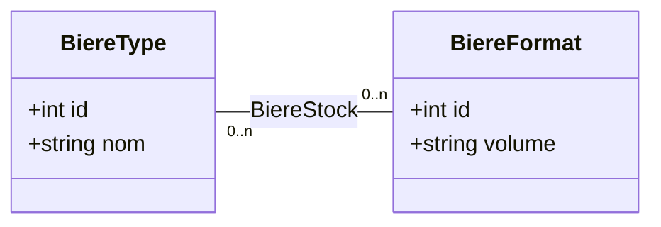

# Tutoriel pas à pas — Construire l'API de gestion de bières

Ce guide permet de construire une API REST Dart avec SQLite, depuis un projet
vide jusqu'aux routes HTTP. Il couvre la base de données,
les requêtes SQL, la validation HTTP, les gestionnaires et le démarrage du
serveur. Le moteur HTTP est fourni par Shelf : il n'est pas nécessaire de
réimplémenter HTTP.

Les premières étapes construisent l'API et la vérifient manuellement avec
`curl`. La dernière partie ajoute des tests automatisés, limités aux routes
HTTP de l'API.

## Résultat attendu

L'API gère trois tables :

- `beer_type` : types de bière comme Blonde ou IPA ;
- `beer_format` : formats comme Bouteille 33cl ou Fût 5L ;
- `beer_stock` : association d'un type et d'un format avec une quantité.

Routes obtenues :

| Méthode         | Route             | Description                             |
| --------------- | ----------------- | --------------------------------------- |
| `GET`           | `/`               | Documentation HTML de l'API             |
| `GET`           | `/echo/<message>` | Route simple de démonstration           |
| `GET`           | `/beers`          | Liste des stocks avec leurs libellés    |
| `GET`           | `/beers/<id>`     | Détail d'un stock avec ses libellés     |
| `POST`          | `/beers`          | Création d'un stock                     |
| `GET`, `POST`   | `/types`          | Liste et création des types             |
| `PUT`, `DELETE` | `/types/<id>`     | Modification et suppression d'un type   |
| `GET`, `POST`   | `/formats`        | Liste et création des formats           |
| `PUT`, `DELETE` | `/formats/<id>`   | Modification et suppression d'un format |

## Partie 1 — Concevoir et implémenter l'API

### 1. Créer le projet et les dépendances

Créez un projet Dart de type serveur, ou utilisez le dépôt existant. Les
éléments de ce tutoriel s'organisent ainsi :

```text
# Organisation des fichiers du projet
.
├── bin/
│   └── server.dart
├── lib/
│   ├── api/
│   │   ├── api_documentation.dart
│   │   ├── api_handler.dart
│   │   ├── api_helpers.dart
│   │   ├── beer_format_handler.dart
│   │   ├── beer_stock_handler.dart
│   │   └── beer_type_handler.dart
│   └── database/
│       └── database_service.dart
├── analysis_options.yaml
└── pubspec.yaml
```

Le nom du package est important : les imports du serveur utilisent
`package:dart_apirest/...`. Définissez-le dans `pubspec.yaml` :

```yaml
# Identité et version du package
name: dart_apirest
description: API REST de gestion de stocks de bière avec Dart et SQLite.
version: 1.0.0

# Version minimale du SDK Dart
environment:
  sdk: ^3.9.2

# Dépendances nécessaires à l'application
dependencies:
  shelf: ^1.4.2
  shelf_router: ^1.1.2
  sqlite3: ^2.4.0

# Outils utilisés pendant le développement
dev_dependencies:
  lints: ^6.0.0
```

Les dépendances ont les rôles suivants :

- `shelf` démarre le serveur et fournit les objets requête/réponse ;
- `shelf_router` associe méthodes et chemins aux fonctions de l'API ;
- `sqlite3` ouvre la base et exécute les requêtes SQLite ;
- `lints` active l'analyse statique Dart.

Créez les dossiers indiqués, puis récupérez les paquets :

```bash
# Crée les répertoires qui accueilleront le serveur et ses composants
mkdir -p bin lib/api lib/db
# Télécharge les dépendances déclarées dans pubspec.yaml
dart pub get
```

### 2. Concevoir le modèle relationnel

Une ligne de stock contient une référence à un type et à un format. La
structure relationnelle est donc :



Les clés primaires sont les colonnes `id`. Les colonnes `idType` et `idFormat`
de `beer_stock` sont des clés étrangères. Elles évitent de recopier les
libellés et garantissent que chaque stock se rapporte à des lignes existantes.

Le schéma de ce projet est volontairement simple :

- les identifiants sont créés automatiquement ;
- les libellés sont obligatoires ;
- un stock doit avoir un type et un format valides ;
- une suppression de type ou de format référencé est refusée par SQLite ;
- la quantité est un entier dans l'API, mais la table ne lui applique pas de
  contrainte `NOT NULL` ou `CHECK`.

### 3. Créer le service SQLite

Créez `lib/database/database_service.dart`. Ce service ouvre la base, crée les tables, ajoute
un jeu initial et regroupe toutes les requêtes SQL.

```dart
import 'package:sqlite3/sqlite3.dart';

class DatabaseService {
  DatabaseService({this.path = 'beer_stock.db'});

  // Le chemin est configurable, avec un fichier local par défaut.
  final String path;
  late final Database _db;

  void initialize() {
    _db = sqlite3.open(path);
    // SQLite désactive les clés étrangères par défaut pour chaque connexion.
    _db.execute('PRAGMA foreign_keys = ON');

    // Les tables de référence sont créées avant la table qui les relie.
    _db.execute('''
      CREATE TABLE IF NOT EXISTS beer_type (
        id INTEGER PRIMARY KEY AUTOINCREMENT,
        libelle TEXT NOT NULL
      );
    ''');
    _db.execute('''
      CREATE TABLE IF NOT EXISTS beer_format (
        id INTEGER PRIMARY KEY AUTOINCREMENT,
        libelle TEXT NOT NULL
      );
    ''');
    _db.execute('''
      CREATE TABLE IF NOT EXISTS beer_stock (
        id INTEGER PRIMARY KEY AUTOINCREMENT,
        idFormat INTEGER NOT NULL,
        idType INTEGER NOT NULL,
        quantite INTEGER,
        FOREIGN KEY (idFormat) REFERENCES beer_format (id),
        FOREIGN KEY (idType) REFERENCES beer_type (id)
      );
    ''');

    // N'insérer les exemples qu'une fois, sur une base encore vide.
    final typeCount = _db.select('SELECT COUNT(*) AS count FROM beer_type');
    if (typeCount.first['count'] == 0) {
      _db.execute(
        "INSERT INTO beer_type (libelle) "
        "VALUES ('Blonde'), ('Brune'), ('Ambrée'), ('IPA')",
      );
      _db.execute(
        "INSERT INTO beer_format (libelle) "
        "VALUES ('Bouteille 33cl'), ('Bouteille 75cl'), "
        "('Canette 50cl'), ('Fût 5L')",
      );

      final typeId = _db
          .select("SELECT id FROM beer_type WHERE libelle = 'Blonde'")
          .first['id'] as int;
      final formatId = _db
          .select(
            "SELECT id FROM beer_format "
            "WHERE libelle = 'Bouteille 33cl' ORDER BY id DESC",
          )
          .first['id'] as int;
      addBeerStock(idFormat: formatId, idType: typeId, quantite: 120);
    }
  }

  ResultSet getBeers() {
    // Les jointures exposent les libellés plutôt que les clés étrangères.
    return _db.select('''
      SELECT
        bs.id,
        bt.libelle AS type,
        bf.libelle AS format,
        bs.quantite
      FROM beer_stock bs
      JOIN beer_type bt ON bs.idType = bt.id
      JOIN beer_format bf ON bs.idFormat = bf.id;
    ''');
  }

  void addBeerStock({
    required int idFormat,
    required int idType,
    required int quantite,
  }) {
    // Les valeurs sont liées aux paramètres pour éviter de concaténer du SQL.
    _db.execute(
      'INSERT INTO beer_stock (idFormat, idType, quantite) VALUES (?, ?, ?)',
      [idFormat, idType, quantite],
    );
  }

  ResultSet getTypes() {
    return _db.select('SELECT * FROM beer_type ORDER BY libelle');
  }

  void addType({required String libelle}) {
    _db.execute('INSERT INTO beer_type (libelle) VALUES (?)', [libelle]);
  }

  bool updateType({required int id, required String libelle}) {
    _db.execute('UPDATE beer_type SET libelle = ? WHERE id = ?', [
      libelle,
      id,
    ]);
    return _db.updatedRows > 0;
  }

  bool deleteType({required int id}) {
    _db.execute('DELETE FROM beer_type WHERE id = ?', [id]);
    return _db.updatedRows > 0;
  }

  ResultSet getFormats() {
    return _db.select('SELECT * FROM beer_format ORDER BY libelle');
  }

  void addFormat({required String libelle}) {
    _db.execute('INSERT INTO beer_format (libelle) VALUES (?)', [libelle]);
  }

  bool updateFormat({required int id, required String libelle}) {
    _db.execute('UPDATE beer_format SET libelle = ? WHERE id = ?', [
      libelle,
      id,
    ]);
    return _db.updatedRows > 0;
  }

  bool deleteFormat({required int id}) {
    _db.execute('DELETE FROM beer_format WHERE id = ?', [id]);
    return _db.updatedRows > 0;
  }

  void dispose() {
    // Libère la connexion SQLite lors de l'arrêt du serveur.
    _db.dispose();
  }
}
```

#### Comprendre les requêtes

- `sqlite3.open(path)` ouvre la base ou la crée si elle n'existe pas ;
- `PRAGMA foreign_keys = ON` active les contraintes de clés étrangères pour
  cette connexion ;
- `CREATE TABLE IF NOT EXISTS` crée chaque table uniquement si elle est
  absente ;
- `?` est un paramètre SQL : les valeurs ne doivent pas être concaténées dans
  la requête ;
- `getBeers()` fait une jointure pour retourner `type` et `format` en clair ;
- `updatedRows` indique si un `UPDATE` ou `DELETE` a touché une ligne ;
- `dispose()` ferme la connexion SQLite.

Les données d'exemple ne sont ajoutées que si `beer_type` est vide. En
conséquence, si vous avez déjà une base créée, le démarrage ne réinitialise pas
son contenu. De même, `CREATE TABLE IF NOT EXISTS` ne migre pas une table
existante lorsqu'on change sa définition.

### 4. Ajouter les utilitaires HTTP

Créez `lib/api/api_helpers.dart`. Les fonctions de ce fichier sont partagées par
les gestionnaires : elles lisent le JSON, encodent les réponses, valident les
identifiants et traduisent les erreurs.

```dart
import 'dart:convert';
import 'dart:io';

import 'package:shelf/shelf.dart';
import 'package:shelf_router/shelf_router.dart';
import 'package:sqlite3/sqlite3.dart';

Middleware get handleErrors =>
    (innerHandler) => (request) async {
      try {
        return await innerHandler(request);
      } on FormatException catch (error) {
        // Une entrée invalide est une erreur imputable à la requête cliente.
        return Response(400, body: error.message);
      } on SqliteException catch (error, stackTrace) {
        if (error.extendedResultCode == 787) {
          // Une référence étrangère invalide empêche la suppression ou l'insertion.
          return Response(409, body: 'Conflicting database reference.');
        }
        // Journaliser le détail côté serveur sans le révéler dans la réponse.
        stderr.writeln('Database error: $error\n$stackTrace');
        return Response.internalServerError(body: 'Internal server error.');
      } catch (error, stackTrace) {
        stderr.writeln('API error: $error\n$stackTrace');
        return Response.internalServerError(body: 'Internal server error.');
      }
    };

// Toutes les réponses de collection partagent le même format JSON.
Response jsonResponse(Object data) => Response.ok(
  jsonEncode(data),
  headers: {'Content-Type': 'application/json'},
);

Future<Map<String, dynamic>> readJson(Request request) async {
  final Object? data;
  try {
    // Le corps Shelf est asynchrone et doit être décodé avant validation.
    data = jsonDecode(await request.readAsString());
  } on FormatException {
    throw const FormatException('Invalid JSON body.');
  }
  if (data is! Map<String, dynamic>) {
    throw const FormatException('Expected a JSON object.');
  }
  return data;
}

int readId(Request request) {
  // Un identifiant absent ou non numérique est traité comme une entrée invalide.
  final id = int.tryParse(request.params['id'] ?? '');
  if (id == null) throw const FormatException('Invalid ID format.');
  return id;
}
```

Le middleware donne un comportement cohérent à toutes les routes :

- `FormatException` devient une réponse `400` ;
- une violation SQLite de clé étrangère (code étendu `787`) devient `409` ;
- les autres erreurs sont journalisées côté serveur et renvoient `500` sans
  exposer le détail SQLite au client.

`readJson()` n'accepte qu'un objet JSON. `readId()` transforme le paramètre de
route en entier.

#### Comment lire une route API

Une route est le contrat entre un client et le serveur. Elle se compose de :

1. **une méthode HTTP**, qui indique l'action (`GET`, `POST`, `PUT` ou
   `DELETE`) ;
2. **un chemin**, qui identifie la ressource (`/types`, `/formats/3`) ;
3. **des données entrantes**, éventuellement dans l'URL ou le corps JSON ;
4. **une réponse**, avec un code HTTP et, parfois, un corps.

Par exemple :

```http
PUT /types/3
Content-Type: application/json

{"libelle":"Stout"}
```

Cette requête signifie « remplacer le libellé du type dont l'identifiant est
3 ». L'identifiant est dans le chemin et le nouveau libellé est dans le corps.
Le serveur répond avec un code et un corps ; dans ce projet, les opérations
réussies renvoient un message texte, tandis que les routes `GET` renvoient du
JSON.

Les méthodes ont ici les rôles suivants :

| Méthode  | Intention                                       | Exemple           |
| -------- | ----------------------------------------------- | ----------------- |
| `GET`    | Lire sans modifier les données                  | `GET /types`      |
| `POST`   | Créer une ressource                             | `POST /types`     |
| `PUT`    | Remplacer les données d'une ressource existante | `PUT /types/3`    |
| `DELETE` | Supprimer une ressource                         | `DELETE /types/3` |

Le nom du chemin correspond à la ressource, et non à une action : on utilise
`POST /types` plutôt qu'un chemin comme `/createType`. Le segment `<id>` est un
paramètre dynamique reconnu par `shelf_router`.

Avant de coder, établissez ce contrat pour chaque famille de routes :

| Route                  | Données reçues                           | Action SQL              | Réponse nominale  |
| ---------------------- | ---------------------------------------- | ----------------------- | ----------------- |
| `GET /types`           | aucune                                   | `SELECT`                | `200`, liste JSON |
| `POST /types`          | `libelle` chaîne                         | `INSERT`                | `201`, message    |
| `PUT /types/<id>`      | id entier + `libelle` chaîne             | `UPDATE`                | `200`, ou `404`   |
| `DELETE /types/<id>`   | id entier                                | `DELETE`                | `200`, ou `404`   |
| `GET /formats`         | aucune                                   | `SELECT`                | `200`, liste JSON |
| `POST /formats`        | `libelle` chaîne                         | `INSERT`                | `201`, message    |
| `PUT /formats/<id>`    | id entier + `libelle` chaîne             | `UPDATE`                | `200`, ou `404`   |
| `DELETE /formats/<id>` | id entier                                | `DELETE`                | `200`, ou `404`   |
| `GET /beers`           | aucune                                   | `SELECT` avec jointures | `200`, liste JSON |
| `GET /beers/<id>`      | id entier                               | `SELECT` avec jointures | `200`, objet JSON ou `404` |
| `POST /beers`          | `idType`, `idFormat`, `quantite` entiers | `INSERT`                | `201`, ou `409`   |

### 5. Implémenter les routes des types

Créez `lib/api/beer_type_handler.dart`. Un gestionnaire reçoit le service de base de
données par son constructeur : il ne crée pas une deuxième connexion.

```dart
import 'package:shelf/shelf.dart';

import '../database/database_service.dart';
import 'api_helpers.dart';

class BeerTypeHandler {
  // Le gestionnaire réutilise le service initialisé par l'application.
  BeerTypeHandler(this._dbService);

  final DatabaseService _dbService;

  // Convertit les lignes du service en réponse JSON.
  Response getAll(Request request) =>
      jsonResponse(_dbService.getTypes().toList());

  Future<Response> create(Request request) async {
    // La validation du corps est partagée avec la mise à jour.
    _dbService.addType(libelle: await _readLabel(request));
    return Response(201, body: 'Beer type created successfully.\n');
  }

  Future<Response> update(Request request) async {
    // Valider l'identifiant et le libellé avant d'appeler SQLite.
    final id = readId(request);
    final label = await _readLabel(request);
    return _dbService.updateType(id: id, libelle: label)
        ? Response.ok('Beer type updated successfully.\n')
        : Response.notFound('Beer type not found.\n');
  }

  Response delete(Request request) => _dbService.deleteType(id: readId(request))
      ? Response.ok('Beer type deleted successfully.\n')
      : Response.notFound('Beer type not found.\n');

  Future<String> _readLabel(Request request) async {
    final data = await readJson(request);
    final label = data['libelle'];
    // Le champ doit exister et contenir une chaîne non vide.
    if (label is! String || label.isEmpty) {
      throw const FormatException('Missing or invalid field: libelle');
    }
    return label;
  }
}
```

#### Comprendre chaque méthode du gestionnaire

La déclaration `BeerTypeHandler(this._dbService)` reçoit le service SQLite créé au
démarrage. Ainsi, le gestionnaire ne connaît pas le chemin du fichier de base
et ne crée pas de connexion. Il demande simplement au service d'exécuter
l'opération voulue.

##### Lire : `GET /types`

```dart
// Le gestionnaire renvoie ici la collection de types sous forme JSON.
Response getAll(Request request) =>
    jsonResponse(_dbService.getTypes().toList());
```

1. Le routeur appelle `getAll` quand il reçoit `GET /types`.
2. `getTypes()` exécute le `SELECT` dans SQLite et retourne un `ResultSet`.
3. `toList()` transforme le résultat en liste de lignes encodables en JSON.
4. `jsonResponse()` sérialise la liste et ajoute l'en-tête
   `Content-Type: application/json`.

Le corps ressemble à ceci (les identifiants réels dépendent de la base) :

```json
[
  {"id":1,"libelle":"Blonde"},
  {"id":2,"libelle":"Brune"}
]
```

La route ne reçoit pas de corps et ne modifie aucune table.

##### Créer : `POST /types`

```dart
Future<Response> create(Request request) async {
  // Lit, valide puis insère le libellé reçu dans le corps JSON.
  _dbService.addType(libelle: await _readLabel(request));
  return Response(201, body: 'Beer type created successfully.\n');
}
```

Le parcours est :

1. Shelf fournit l'objet `Request` au gestionnaire.
2. `_readLabel()` lit le corps asynchrone de la requête.
3. `readJson()` vérifie que le corps est un objet JSON.
4. `_readLabel()` récupère `libelle` et vérifie que c'est une chaîne non vide.
5. `addType()` exécute l'`INSERT` paramétré.
6. La réponse `201 Created` indique qu'une ressource a été créée.

Le client envoie par exemple :

```http
POST /types
Content-Type: application/json

{"libelle":"Stout"}
```

Si le JSON est mal formé, si le corps est un tableau plutôt qu'un objet, ou si
`libelle` est absent ou n'est pas une chaîne, une `FormatException` remonte
jusqu'au middleware et devient une réponse `400`.

##### Modifier : `PUT /types/<id>`

```dart
Future<Response> update(Request request) async {
  // L'identifiant vient de l'URL ; le nouveau libellé vient du corps JSON.
  final id = readId(request);
  final label = await _readLabel(request);
  return _dbService.updateType(id: id, libelle: label)
      ? Response.ok('Beer type updated successfully.\n')
      : Response.notFound('Beer type not found.\n');
}
```

Ici, l'ordre est volontaire :

1. `readId(request)` lit le segment dynamique de l'URL et vérifie qu'il est
   numérique. `/types/abc` est donc une erreur `400`.
2. `_readLabel(request)` valide le JSON, comme lors d'une création.
3. `updateType()` exécute `UPDATE beer_type SET libelle = ? WHERE id = ?`.
4. Le booléen retourné indique si une ligne a été modifiée.
5. Le gestionnaire choisit `200 OK` si la ligne existe, sinon `404 Not Found`.

La requête correspondante est :

```http
PUT /types/3
Content-Type: application/json

{"libelle":"Imperial Stout"}
```

##### Supprimer : `DELETE /types/<id>`

```dart
// Une suppression ne lit pas de corps : l'id de la route suffit.
Response delete(Request request) => _dbService.deleteType(id: readId(request))
    ? Response.ok('Beer type deleted successfully.\n')
    : Response.notFound('Beer type not found.\n');
```

Il n'y a pas de corps JSON à lire : seul l'identifiant dans le chemin est
nécessaire. Le service essaie de supprimer la ligne et retourne `true` si une
ligne a été supprimée. Le gestionnaire renvoie alors `200`, ou `404` si cet
identifiant n'existe pas.

Si le type est référencé dans `beer_stock`, SQLite refuse la suppression.
L'exception remonte au middleware, qui renvoie `409 Conflict`. La contrainte
de base de données protège ainsi les données, même si une autre route tente un
jour d'effectuer cette suppression.

La méthode `_readLabel()` est privée car elle n'est utile qu'à ce gestionnaire.
Elle évite de répéter la même validation dans `create()` et `update()`.

### 6. Implémenter les routes des formats

Créez `lib/api/beer_format_handler.dart`. Ce gestionnaire suit le même contrat que
celui des types et appelle les méthodes correspondantes du service :

```dart
import 'package:shelf/shelf.dart';

import '../database/database_service.dart';
import 'api_helpers.dart';

class BeerFormatHandler {
  // Le service partagé donne accès aux opérations SQL sur les formats.
  BeerFormatHandler(this._dbService);

  final DatabaseService _dbService;

  // Suit le même contrat de lecture que le gestionnaire des types.
  Response getAll(Request request) =>
      jsonResponse(_dbService.getFormats().toList());

  Future<Response> create(Request request) async {
    // Réutilise la validation du libellé avant l'insertion.
    _dbService.addFormat(libelle: await _readLabel(request));
    return Response(201, body: 'Beer format created successfully.\n');
  }

  Future<Response> update(Request request) async {
    // Retourne 404 lorsque l'identifiant ne correspond à aucune ligne.
    final id = readId(request);
    final label = await _readLabel(request);
    return _dbService.updateFormat(id: id, libelle: label)
        ? Response.ok('Beer format updated successfully.\n')
        : Response.notFound('Beer format not found.\n');
  }

  Response delete(Request request) =>
      _dbService.deleteFormat(id: readId(request))
      ? Response.ok('Beer format deleted successfully.\n')
      : Response.notFound('Beer format not found.\n');

  Future<String> _readLabel(Request request) async {
    final data = await readJson(request);
    final label = data['libelle'];
    // Refuse les valeurs absentes, vides ou d'un type inattendu.
    if (label is! String || label.isEmpty) {
      throw const FormatException('Missing or invalid field: libelle');
    }
    return label;
  }
}
```

Le code est presque identique à `BeerTypeHandler`, mais chaque méthode travaille
sur `beer_format` au lieu de `beer_type` et renvoie des messages adaptés. Cette
similarité est utile pour apprendre à reconnaître une ressource REST classique :
liste, création, modification par identifiant et suppression par identifiant.

Pour ajouter une ressource comparable, on répète ces étapes :

1. créer ses opérations SQL dans `DatabaseService` ;
2. créer un gestionnaire avec les méthodes `getAll`, `create`, `update` et
   `delete` ;
3. valider les entrées avant d'appeler SQLite ;
4. traduire le résultat de SQLite en code HTTP ;
5. enregistrer les quatre routes dans le routeur.

### 7. Implémenter les routes des stocks

Créez `lib/api/beer_stock_handler.dart`. Le stock permet ici de consulter la liste et
d'ajouter une ligne ; les routes de modification et suppression des stocks ne
font pas partie du projet actuel.

```dart
import 'package:shelf/shelf.dart';

import '../database/database_service.dart';
import 'api_helpers.dart';

class BeerStockHandler {
  // Ce gestionnaire ne crée pas sa propre connexion à la base.
  BeerStockHandler(this._dbService);

  final DatabaseService _dbService;

  // Le service joint les tables avant la sérialisation en JSON.
  Response getAll(Request request) =>
      jsonResponse(_dbService.getBeers().toList());

  Future<Response> create(Request request) async {
    final data = await readJson(request);
    final idType = data['idType'];
    final idFormat = data['idFormat'];
    final quantite = data['quantite'];
    // Les trois champs doivent être des entiers avant l'insertion.
    if (idType is! int || idFormat is! int || quantite is! int) {
      throw const FormatException(
        'Missing or invalid fields: idType, idFormat, quantite',
      );
    }
    _dbService.addBeerStock(
      // Les clés étrangères SQLite vérifieront l'existence de ces identifiants.
      idFormat: idFormat,
      idType: idType,
      quantite: quantite,
    );
    return Response(201, body: 'Beer stock created successfully.\n');
  }
}
```

#### Lire la liste : `GET /beers`

`getAll()` appelle `getBeers()`, qui joint les trois tables. Le client reçoit
les libellés lisibles plutôt que les clés étrangères :

```json
[
  {
    "id":1,
    "type":"Blonde",
    "format":"Bouteille 33cl",
    "quantite":120
  }
]
```

La requête SQL utilise des `JOIN` car `beer_stock` ne stocke que `idType` et
`idFormat`. La route retourne `200 OK` et une liste JSON, éventuellement vide.

#### Lire un stock : `GET /beers/<id>`

La route utilise le même `SELECT` avec jointures que la liste, filtré par
l'identifiant du stock. Elle retourne un objet JSON avec ses libellés, `404 Not
Found` si le stock n'existe pas, ou `400 Bad Request` si l'identifiant n'est
pas un entier.

#### Créer un stock : `POST /beers`

Le corps doit contenir trois nombres entiers :

```json
{"idType":1,"idFormat":1,"quantite":150}
```

Le gestionnaire valide le type des champs avant l'appel à
`addBeerStock()`. Il ne vérifie pas lui-même que les identifiants existent :
c'est le rôle des clés étrangères SQLite. Cela évite de dupliquer la règle
dans la couche HTTP.

- champ manquant ou valeur non entière : `400 Bad Request` ;
- type ou format inexistant : `409 Conflict` ;
- insertion réussie : `201 Created`.

Une quantité négative est acceptée par le schéma actuel : ajoutez une
contrainte `CHECK` si la règle métier doit l'interdire.

Les routes `PUT` et `DELETE` des stocks ne sont pas déclarées : ce guide
reproduit le périmètre actuel, pas un CRUD plus large que l'application.

### 8. Déclarer toutes les routes

Créez `lib/api/api_handler.dart`. Le routeur construit un gestionnaire par
ressource, déclare les chemins, puis enveloppe toutes les routes dans le
middleware d'erreurs.

```dart
import 'package:shelf/shelf.dart';
import 'package:shelf_router/shelf_router.dart';

import '../database/database_service.dart';
import 'api_documentation.dart';
import 'api_helpers.dart';
import 'beer_format_handler.dart';
import 'beer_stock_handler.dart';
import 'beer_type_handler.dart';

class ApiHandler {
  // Tous les gestionnaires partagent la même instance du service SQLite.
  ApiHandler(this._dbService);

  final DatabaseService _dbService;

  Handler get router {
    final beers = BeerStockHandler(_dbService);
    final types = BeerTypeHandler(_dbService);
    final formats = BeerFormatHandler(_dbService);
    // Chaque déclaration associe une méthode HTTP à son gestionnaire.
    final routes = Router()
      ..get('/', _rootHandler)
      ..get('/echo/<message>', _echoHandler)
      ..get('/beers', beers.getAll)
      ..post('/beers', beers.create)
      ..get('/types', types.getAll)
      ..post('/types', types.create)
      ..put('/types/<id>', types.update)
      ..delete('/types/<id>', types.delete)
      ..get('/formats', formats.getAll)
      ..post('/formats', formats.create)
      ..put('/formats/<id>', formats.update)
      ..delete('/formats/<id>', formats.delete);
    // Le middleware enveloppe toutes les routes pour uniformiser les erreurs.
    return const Pipeline().addMiddleware(handleErrors).addHandler(routes.call);
  }

  Response _rootHandler(Request request) => Response.ok(
    ApiDocumentation.htmlContent,
    headers: {'Content-Type': 'text/html; charset=utf-8'},
  );

  Response _echoHandler(Request request) =>
      Response.ok('${request.params['message'] ?? 'default'}\n');
}
```

#### Lire les déclarations du routeur

La cascade `..get(...)`, `..post(...)`, etc. construit progressivement un seul
objet `Router`. Chaque appel associe une méthode, un motif de chemin et une
fonction :

```dart
// Route dynamique : <id> est disponible dans request.params['id'].
..put('/types/<id>', types.update)
```

Cela signifie : pour une requête `PUT` dont le chemin correspond à
`/types/<id>`, appeler `types.update`. Le routeur place la valeur trouvée dans
`request.params['id']`, puis `readId()` la convertit en entier.

Le même chemin peut donc avoir plusieurs comportements selon la méthode :
`GET /types` lit la liste tandis que `POST /types` crée une ligne. Pour un
identifiant, le routeur distingue de la même façon `PUT /types/3` et
`DELETE /types/3`.

Les trois gestionnaires sont construits avec le même `DatabaseService` :
`BeerStockHandler(_dbService)`, `BeerTypeHandler(_dbService)` et
`BeerFormatHandler(_dbService)`. Ils partagent donc la connexion SQLite initialisée
au démarrage.

La dernière ligne :

```dart
// Le middleware intercepte les erreurs levées pendant le traitement d'une route.
return const Pipeline().addMiddleware(handleErrors).addHandler(routes.call);
```

place le middleware d'erreurs autour du routeur. Lorsqu'un gestionnaire lève
une exception de validation ou SQLite, le middleware peut la transformer en
réponse HTTP au lieu de laisser l'erreur terminer la requête sans réponse
contrôlée.

Les requêtes inconnues (par exemple `GET /inconnue`) ne correspondent à aucune
route ; Shelf Router renvoie une réponse `404`.

### 9. Ajouter la page de documentation HTML

Créez `lib/api/api_documentation.dart`. Cette page est servie par `GET /` et
présente quelques exemples directement dans le navigateur.

```dart
class ApiDocumentation {
  static const String htmlContent = '''
<!DOCTYPE html>
<html>
<head>
  <meta charset="utf-8">
  <title>Documentation API Bières</title>
  <!-- Styles légers pour distinguer les méthodes et les exemples. -->
  <style>
    body { font-family: Arial, sans-serif; line-height: 1.6; padding: 2em; color: #333; }
    h1, h2, h3 { color: #222; }
    code, pre { background: #f6f8fa; padding: .5em; border-radius: 6px; }
    .endpoint { border-left: 4px solid #0366d6; padding-left: 1.5em; margin-bottom: 2em; }
    .method { font-weight: bold; color: #0366d6; }
  </style>
</head>
<body>
  <h1>Documentation API Bières</h1>
  <p>API de gestion de stock de bières.</p>

  <!-- Les sections ci-dessous décrivent les routes exposées par le serveur. -->
  <h2>Stocks</h2>
  <div class="endpoint">
    <h3><span class="method">GET</span> /beers</h3>
    <p>Récupère tous les stocks.</p>
    <pre><code>curl http://localhost:8080/beers</code></pre>
  </div>
  <div class="endpoint">
    <h3><span class="method">POST</span> /beers</h3>
    <p>Ajoute un stock à partir d'identifiants existants.</p>
    <pre><code>{"idType":1,"idFormat":2,"quantite":150}</code></pre>
  </div>

  <h2>Types</h2>
  <div class="endpoint">
    <h3><span class="method">GET</span> /types</h3>
    <p>Liste les types de bière.</p>
    <pre><code>curl http://localhost:8080/types</code></pre>
  </div>
  <div class="endpoint">
    <h3><span class="method">POST</span> /types</h3>
    <p>Crée un type, par exemple :</p>
    <pre><code>{"libelle":"Stout"}</code></pre>
  </div>
  <div class="endpoint">
    <h3><span class="method">PUT</span> /types/<id></h3>
    <p>Modifie le libellé d'un type.</p>
  </div>
  <div class="endpoint">
    <h3><span class="method">DELETE</span> /types/<id></h3>
    <p>Supprime un type s'il n'est pas utilisé par un stock.</p>
  </div>

  <h2>Formats</h2>
  <div class="endpoint">
    <h3><span class="method">GET</span> /formats</h3>
    <p>Liste les formats de conditionnement.</p>
    <pre><code>curl http://localhost:8080/formats</code></pre>
  </div>
  <div class="endpoint">
    <h3><span class="method">POST</span> /formats</h3>
    <p>Crée un format, par exemple :</p>
    <pre><code>{"libelle":"Canette 50cl"}</code></pre>
  </div>
  <div class="endpoint">
    <h3><span class="method">PUT</span> /formats/<id></h3>
    <p>Modifie le libellé d'un format.</p>
  </div>
  <div class="endpoint">
    <h3><span class="method">DELETE</span> /formats/<id></h3>
    <p>Supprime un format s'il n'est pas utilisé par un stock.</p>
  </div>
</body>
</html>
''';
}
```

## Partie 2 — Lancer et vérifier l'API

### 10. Démarrer le serveur

Créez `bin/server.dart`. Le serveur initialise la base avant d'accepter des
requêtes, ajoute la journalisation Shelf et ferme proprement le serveur et la
base à la réception de `Ctrl+C`.

```dart
import 'dart:io';

import 'package:dart_apirest/api/api_handler.dart';
import 'package:dart_apirest/database/database_service.dart';
import 'package:shelf/shelf.dart';
import 'package:shelf/shelf_io.dart';

Future<void> main() async {
  // Prépare la base avant de construire et démarrer le serveur HTTP.
  final dbService = DatabaseService();
  dbService.initialize();

  final apiHandler = ApiHandler(dbService);
  final handler = Pipeline()
      .addMiddleware(logRequests())
      .addHandler(apiHandler.router);

  // PORT permet de remplacer le port par défaut dans l'environnement.
  final port = int.parse(Platform.environment['PORT'] ?? '8080');
  final server = await serve(handler, InternetAddress.anyIPv4, port);
  print('Server listening on port ${server.port}');

  ProcessSignal.sigint.watch().listen((_) async {
    // Fermer le serveur et la base lors de Ctrl+C.
    print('\nShutting down server...');
    await server.close(force: true);
    dbService.dispose();
    exit(0);
  });
}
```

Le serveur écoute sur toutes les interfaces IPv4, ce qui le rend accessible
depuis un conteneur ou une autre machine selon la configuration réseau. Le
port peut être choisi avec la variable d'environnement `PORT`.

### 11. Configurer l'analyse statique et lancer l'application

Pour utiliser les règles de lint recommandées, créez
`analysis_options.yaml` :

```yaml
# Active les règles de lint recommandées pour Dart.
include: package:lints/recommended.yaml
```

Depuis la racine du projet :

```bash
# Récupère les dépendances, puis vérifie le code avant de démarrer le serveur.
dart pub get
dart analyze
dart run bin/server.dart
```

La base `beer_stock.db` est créée dans le répertoire courant. Sur Linux, si
l'ouverture SQLite échoue à cause de la bibliothèque native, installez le
paquet système qui fournit `libsqlite3.so`.

### 12. Vérifier les routes avec curl

Laissez le serveur tourner dans un terminal et lancez les commandes suivantes
dans un autre. L'option `-i` de `curl` affiche aussi la ligne de statut et les
en-têtes HTTP ; sans `-i`, vous ne voyez que le corps de la réponse.

#### Lire les données de départ

```bash
# Consulte la page d'accueil, les collections et la route de démonstration.
curl -i http://localhost:8080/
curl -i http://localhost:8080/types
curl -i http://localhost:8080/formats
curl -i http://localhost:8080/beers
curl -i http://localhost:8080/echo/bonjour
```

Les routes de listes répondent avec du JSON. Les types et formats de départ
sont ajoutés par `DatabaseService.initialize()` si la base ne contient encore
aucun type. `GET /` répond en HTML, `GET /echo/bonjour` renvoie simplement le
texte `bonjour`, et les trois routes de listes répondent `200 OK`.

#### Créer un type, puis retrouver son identifiant

```bash
# Crée un type en envoyant un objet JSON.
curl -i -X POST http://localhost:8080/types \
  -H 'Content-Type: application/json' \
  -d '{"libelle":"Stout"}'
```

La réponse doit avoir le statut `201 Created`. Pour retrouver l'identifiant
généré par SQLite, relisez la collection :

```bash
# Relit la collection pour retrouver l'identifiant attribué par SQLite.
curl -i http://localhost:8080/types
```

Repérez l'objet `"libelle":"Stout"` et notez son `id`. N'assumez pas que le
prochain identifiant vaut toujours `5` : la base peut déjà contenir d'autres
données.

#### Créer un format

```bash
# Crée un format ; son identifiant sera déterminé en relisant la collection.
curl -i -X POST http://localhost:8080/formats \
  -H 'Content-Type: application/json' \
  -d '{"libelle":"Bouteille 25cl"}'
```

La création répond aussi `201`. Appelez ensuite `GET /formats` et notez l'id
du nouveau format. Les exemples ci-dessous utilisent `<id_type>` et
`<id_format>` comme repères : remplacez-les par les nombres observés (sans les
chevrons).

#### Modifier un type existant

Remplacez `7` par l'identifiant relevé dans la réponse de `GET /types` :

```bash
# Remplace le libellé du type d'identifiant 7.
curl -i -X PUT http://localhost:8080/types/7 \
  -H 'Content-Type: application/json' \
  -d '{"libelle":"Imperial Stout"}'
```

Une réponse `200 OK` signifie que la ligne a été modifiée. Si l'id n'existe
pas, la réponse est `404 Not Found`. Vérifiez la modification avec
`GET /types`.

#### Supprimer les ressources non référencées

Pour observer une suppression réussie, supprimez le format que vous venez de
créer, à condition de ne pas l'avoir déjà utilisé dans un stock :

```bash
# Supprime le format d'exemple s'il n'est référencé par aucun stock.
curl -i -X DELETE http://localhost:8080/formats/8
```

Remplacez `8` par l'identifiant du format que vous venez de créer. Une réponse
`200 OK` signifie que la suppression a réussi ; l'identifiant n'existant pas
répond `404`. Si le format est référencé par un stock, SQLite bloque la
suppression et l'API répond `409 Conflict`. La même règle s'applique à un type
référencé.

#### Ajouter un stock

Utilisez un id de type et un id de format qui existent encore dans la base :

```bash
# Crée un stock à partir d'identifiants existants, puis affiche la collection.
curl -i -X POST http://localhost:8080/beers \
  -H 'Content-Type: application/json' \
  -d '{"idType":1,"idFormat":2,"quantite":150}'

curl -i http://localhost:8080/beers
```

Les ids `1` et `2` ne sont que des exemples : remplacez-les par les ids
existants que vous avez relevés dans `GET /types` et `GET /formats`.

Après l'insertion, `GET /beers` montre le stock avec le libellé du type et du
format. La réponse de création est `201 Created`.

#### Observer les erreurs de validation et de relation

Corps JSON mal formé :

```bash
# Envoie un JSON mal formé pour observer la réponse 400.
curl -i -X POST http://localhost:8080/types \
  -H 'Content-Type: application/json' \
  -d '{'
```

Le serveur répond `400 Bad Request`, car `readJson()` n'a pas pu décoder le
corps. Un champ avec un mauvais type produit aussi `400` :

```bash
# idType est volontairement une chaîne : la validation doit répondre 400.
curl -i -X POST http://localhost:8080/beers \
  -H 'Content-Type: application/json' \
  -d '{"idType":"1","idFormat":1,"quantite":150}'
```

Ici `idType` est une chaîne et non un entier. À l'inverse, si `idType` est un
entier qui n'existe pas, la validation HTTP passe, mais la contrainte de clé
étrangère SQLite échoue : le middleware renvoie `409 Conflict`.

## Partie 3 — Comprendre et tester l'API

### 13. Comprendre la répartition des responsabilités

Une requête suit ce chemin :

```text
# Parcours d'une requête depuis le client jusqu'à la gestion des erreurs
Client HTTP
  -> Shelf reçoit la requête
  -> shelf_router sélectionne le gestionnaire
  -> le gestionnaire valide le chemin et le JSON
  -> DatabaseService exécute une requête SQL paramétrée
  -> le gestionnaire construit la réponse HTTP
  -> le middleware convertit les erreurs inattendues ou SQL
```

Chaque composant a une responsabilité précise :

- `bin/server.dart` initialise et arrête l'application ;
- `lib/api/api_handler.dart` déclare les routes ;
- `lib/api/` valide les données HTTP et choisit les réponses ;
- `lib/database/database_service.dart` détient le schéma et les requêtes SQL ;
- `lib/api/api_helpers.dart` partage les validations et la gestion des erreurs ;
- `lib/api/api_documentation.dart` fournit la documentation HTML de `/`.

### 14. Tester exclusivement les routes de l'API

Cette partie vérifie le contrat HTTP des routes : méthode et chemin, données
reçues, code de statut, en-têtes et corps de réponse. Elle ne teste pas
séparément les requêtes SQL, le démarrage du processus serveur ou Docker.

Le dépôt utilise `package:test`, déjà déclaré dans `dev_dependencies`. Les
tests créent le routeur Shelf et lui envoient directement des objets
`Request`. La base SQLite est en mémoire : les tests ne créent ni ne modifient
`beer_stock.db`. Le paquet Dart `sqlite3` a toutefois besoin de sa bibliothèque
native (`libsqlite3.so` sous Linux), y compris pour ces tests en mémoire.

#### Préparer un client de test

Créez `test/support/api_test_client.dart`. Le client initialise une base
éphémère pour chaque test et permet d'appeler les routes sans ouvrir de port :

```dart
import 'package:dart_apirest/api/api_handler.dart';
import 'package:dart_apirest/database/database_service.dart';
import 'package:shelf/shelf.dart';

class ApiTestClient {
  ApiTestClient() : database = DatabaseService(path: ':memory:')..initialize() {
    // Utilise le même routeur que le serveur, sans démarrer de serveur réseau.
    handler = ApiHandler(database).router;
  }

  final DatabaseService database;
  late final Handler handler;

  Future<Response> send(String method, String path, {String? body}) async {
    // Shelf transmet cette requête au routeur et à ses middlewares.
    return handler(
      Request(method, Uri.parse('http://localhost$path'), body: body),
    );
  }

  void close() => database.dispose();
}
```

Le cycle `setUp` / `tearDown` garantit que chaque test repart des données
d'exemple et ferme sa connexion SQLite :

```dart
late ApiTestClient api;

setUp(() => api = ApiTestClient());
tearDown(() => api.close());
```

#### Tester une route de lecture

Un test de `GET /types` vérifie le statut, le type de contenu et la forme
JSON de la réponse :

```dart
import 'dart:convert';

import 'package:test/test.dart';

import 'support/api_test_client.dart';

void main() {
  late ApiTestClient api;

  setUp(() => api = ApiTestClient());
  tearDown(() => api.close());

  test('GET /types retourne une liste JSON', () async {
    // Appelle la route avec une requête Shelf.
    final response = await api.send('GET', '/types');

    expect(response.statusCode, 200);
    expect(response.headers['content-type'], contains('application/json'));
    expect(jsonDecode(await response.readAsString()), isA<List<dynamic>>());
  });
}
```

#### Couvrir les routes et leurs erreurs

Pour chaque route, couvrir au minimum un cas nominal et les erreurs prévues
par le contrat :

| Route                                        | Cas à vérifier                                                                                                                                |
| -------------------------------------------- | --------------------------------------------------------------------------------------------------------------------------------------------- |
| `GET /types`, `GET /formats`, `GET /beers`   | `200`, en-tête JSON et corps de type liste                                                                                                    |
| `POST /types`, `POST /formats`               | `201` pour un libellé valide ; `400` pour un JSON invalide, un champ absent ou un libellé incorrect                                           |
| `PUT /types/<id>`, `PUT /formats/<id>`       | `200` pour une mise à jour ; `400` pour un id ou un corps invalide ; `404` pour un id inconnu                                                 |
| `DELETE /types/<id>`, `DELETE /formats/<id>` | `200` pour une suppression ; `400` pour un id invalide ; `404` pour un id inconnu ; `409` si la ressource est référencée par un stock         |
| `POST /beers`                                | `201` si les champs et références sont valides ; `400` si le JSON ou les types de champs sont invalides ; `409` si une référence n'existe pas |
| `GET /`, `GET /echo/<message>`               | `200` et le contenu attendu                                                                                                                   |
| Chemin inconnu                               | `404`                                                                                                                                         |

Les tests de création suivis d'une lecture permettent de récupérer l'identifiant
généré sans supposer sa valeur. Pour vérifier `PUT` ou `DELETE`, utilisez cet
identifiant ; pour le cas `404`, choisissez un identifiant absent. Les
réponses d'erreur sont produites par le middleware du routeur, ainsi ces tests
vérifient également la traduction des erreurs de validation et SQLite en
statuts HTTP.

Les tests des routes sont regroupés dans `test/type_routes_test.dart`,
`test/format_routes_test.dart`, `test/beer_routes_test.dart` et
`test/api_handler_test.dart`. Depuis la racine du projet, exécutez toute cette
couverture avec :

```bash
# Exécute uniquement les tests du routeur et des routes de l'API.
dart test test/api_handler_test.dart test/type_routes_test.dart test/format_routes_test.dart test/beer_routes_test.dart
```

Pour relancer un seul groupe de routes, passez uniquement son fichier, par
exemple :

```bash
# Lance les tests des routes liées aux types.
dart test test/type_routes_test.dart
```

La suite `test/server_test.dart` vérifie le lancement du serveur HTTP ; elle
n'est pas incluse ici, car cette section porte exclusivement sur les routes
de l'API.

## Partie 4 — Pistes d'évolution

Une fois les routes actuelles comprises et testées, voici des améliorations
possibles pour faire évoluer l'API :

- **Compléter le CRUD des stocks** : ajouter `PUT` et `DELETE` sur
  `/beers/<id>`.
- **Renforcer les règles métier** : empêcher les quantités négatives avec une
  contrainte SQL `CHECK` et valider les valeurs à la réception.
- **Gérer l'évolution du schéma** : remplacer la création initiale des tables
  par des migrations versionnées.
- **Documenter le contrat** : décrire les routes, les schémas JSON et les
  réponses d'erreur avec OpenAPI.
- **Améliorer les lectures** : ajouter filtres, tri et pagination aux routes
  de collection.
- **Sécuriser l'accès** : ajouter une authentification et contrôler les
  permissions avant les opérations de modification.
- **Renforcer la livraison** : compléter les tests des cas limites et
  automatiser l'analyse et les tests dans une intégration continue.
- **Préparer le déploiement** : externaliser la configuration, les journaux
  et la gestion du cycle de vie du serveur.
